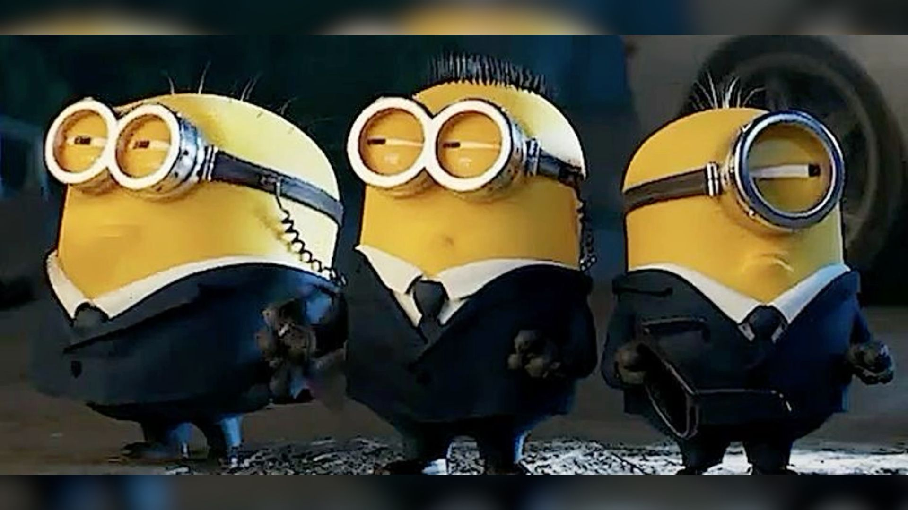

# RandomWalking2D
Исследование модели случайного блуждания на плоскости с равновероятными шагами решетки. Программное моделирование траекторий, статистический анализ смещения и сопоставление с теоретическими законами диффузии.

Пятничное фото, вся братва на месте идёт на гули

